# Paperscape: Design Document

> Plan your ML and networking submissions and run your literature review in one place.

**Authors:** Ayush Nimeshkumar Patel (Conference Planner) · Harshitha Seetharaman (Review Workspace and this document)
**Class:** [CS5610 Web Development, Northeastern University](https://johnguerra.co/classes/webDevelopment_online_summer_2026/index.html)
**Live app:** https://paperscape-odl1.onrender.com

## Contents

0. [Team and responsibilities](#0-team-and-responsibilities)
1. [Project description](#1-project-description)
2. [User personas](#2-user-personas)
3. [User stories](#3-user-stories)
4. [Design process and decisions](#4-design-process-and-decisions)
5. [Mockups](#5-mockups)
6. [Final screens](#6-final-screens)
7. [Data model](#7-data-model)
8. [Architecture](#8-architecture)
9. [API overview](#9-api-overview)
10. [Accessibility, performance and resilience](#10-accessibility-performance-and-resilience)

---

## 0. Team and responsibilities

Paperscape has two halves of equal scope, each owned end to end (data, API, pages, styles) by one author, on a shared scaffold and design system.

|                       | Ayush Nimeshkumar Patel                                                                                        | Harshitha Seetharaman                                                                      |
| --------------------- | -------------------------------------------------------------------------------------------------------------- | ------------------------------------------------------------------------------------------ |
| **Feature area**      | Conference Planner: world map, timeline, list, filters, conference CRUD, submission plans, warnings, home page | Review Workspace: reviews, paper search, reading list, threads, citations, orbit map       |
| **Persona served**    | Nadia (first-year PhD) · stories P1–P4                                                                         | Leo (MS thesis) · stories R1–R4                                                            |
| **Collections**       | `conferences`, `submissionPlans`, `linkReports`                                                                | `papers` (1,262 seeded from OpenAlex), `reviews`, `reviewEntries`                          |
| **API**               | 13 endpoints                                                                                                   | 17 endpoints                                                                               |
| **Frontend**          | 12 planner modules, 5 page stylesheets                                                                         | 22 review modules, 2 page stylesheets                                                      |
| **Data pipeline**     | Conference import and daily tracker (GitHub Action)                                                            | Citation-cluster paper seed; topic vocabulary mined from papers                            |
| **Platform and docs** | Scaffold, Render deployment, [setup guide](SETUP.md), [project plan](PROJECT_PLAN.md)                          | Transactions and resilience patterns, this design document, wireframes and screens, README |

---

## 1. Project description

### The problem

Graduate students in machine learning and networking juggle two jobs that live in different tools:

- **Getting a paper out.** Conference deadlines are scattered over many websites, written in "Anywhere on Earth" time, and moved when extended. Students pick a venue late, forget a backup, and discover too late that the acceptance notification leaves no time for a visa.
- **Understanding a field.** A literature review starts as browser tabs and a spreadsheet. It is hard to see which papers matter most for _your_ question, which ones you have actually read, and how the papers relate to each other.

### Our solution

Paperscape puts both jobs on one site, with no sign-up:

- The **Conference Planner** (Ayush) shows upcoming ML and networking conferences on a hand-drawn world map, a timeline and a filterable list, with live countdowns to every deadline. Students build **submission plans** (a target venue, a backup and their own milestones) and get warned about clashing deadlines or too little time to travel. Conference data refreshes automatically every day.
- The **Review Workspace** (Harshitha) is organised around a **research question**. Students search a library of 1,262 recent papers seeded from OpenAlex, save the ones that matter, record status, relevance, notes and findings, link papers into ordered **threads**, and see **which saved papers cite each other**, as lists and as an orbit map around the question.

### Who it is for

First-year PhD students and thesis-writing master's students in ML-adjacent fields: people who know their research area but are new to planning submissions and running a structured review. Each browser gets an anonymous id, so the site works for anyone the link is shared with, and nobody sees anyone else's plans or reviews.

---

## 2. User personas

### Nadia Rahman: first-year PhD student

|                                    |                                                                                                                                                                            |
| ---------------------------------- | -------------------------------------------------------------------------------------------------------------------------------------------------------------------------- |
| **Background**                     | 24, first-year PhD in computer vision at a large public university; came straight from her undergraduate degree; first paper is due this year.                             |
| **Goals**                          | Submit her first paper to a top venue; have a realistic backup if it is rejected; not miss a deadline because of time zones.                                               |
| **Frustrations**                   | Deadlines live on a dozen conference sites; "AoE" confuses her; a lab-mate missed a conference because his visa took longer than the gap between acceptance and the event. |
| **Tech comfort**                   | High. Uses GitHub, Overleaf and Slack daily; wants something faster than a spreadsheet, not another account to create.                                                     |
| **What she needs from Paperscape** | One view of upcoming venues in her area, countdowns she can trust, a target + backup plan with milestones, and warnings before problems happen.                            |

### Leo Martins: master's student writing a thesis

|                                   |                                                                                                                                                                                                     |
| --------------------------------- | --------------------------------------------------------------------------------------------------------------------------------------------------------------------------------------------------- |
| **Background**                    | 27, second-year MS in data science, working part-time; his thesis asks how data augmentation affects the robustness of vision transformers.                                                         |
| **Goals**                         | Build a defensible related-work chapter; know which papers he has actually read; find the papers the field builds on; present them in a logical order.                                              |
| **Frustrations**                  | Thirty open tabs and a spreadsheet of titles; forgets why a paper mattered; cannot tell which papers are foundational; loses his place between work shifts.                                         |
| **Tech comfort**                  | Medium. Comfortable with web apps, not with reference-manager plugins or command-line tools. Often works on his phone during commutes.                                                              |
| **What he needs from Paperscape** | A review built around his question, search that is quick to refine, a reading list with notes beside each paper, a way to order papers into an argument, and a picture of how they cite each other. |

---

## 3. User stories

Each story has acceptance criteria that were checked in the finished app.

### Conference Planner (Nadia)

**P1. See upcoming conferences on a world map and timeline, filtered by research area and month.**

- Given conferences exist, the Map, Timeline and List views show the same set and update together when an area chip or month is changed.
- Dates with no announcement show "TBD" and never an estimated date; such conferences sort last.
- Clicking a map pin or timeline row opens a detail panel with dates and deadlines (in AoE).

**P2. Add, edit and delete conference entries.**

- A form adds a conference with name, acronym, year, areas, dates, location and deadlines; invalid input (end before start, abstract after paper deadline) shows a message on the field.
- Seeded conferences cannot be edited directly; "Duplicate" creates an editable copy.
- Deleting a conference used by one of my plans is blocked with an explanation (409).

**P3. Create submission plans with a target venue, a backup, custom milestones and a countdown.**

- A plan needs a paper title and a target; the backup must differ from the target.
- Milestones have a label and a date; "Suggest milestones" counts back from the target's deadline.
- Each plan card shows the next deadline with a countdown that updates without reloading.

**P4. Edit and delete plans; get warned about deadline clashes and travel squeeze.**

- Two deadlines from my plans within 7 days of each other raise a "Deadline clash" warning.
- Less than 6 weeks between notification and conference start raises a "Travel time" warning.
- Delete asks for confirmation and removes the plan with its milestones.

### Review Workspace (Leo)

**R1. Create, edit and delete literature reviews, each built around a research question.**

- A review cannot be created without a research question; the title and research area are suggested from the question's topic and can be changed.
- Editing happens in place on the card or the review header; Esc cancels.
- Deleting a review asks first, lists how many saved papers and threads it removes, and removes them all (cascade, in a transaction).

**R2. Search recent papers by keyword, research area and year; read abstracts; add them to a review.**

- The search is pre-filled from the review's keywords and area; results update 300 ms after typing stops and only the newest response is shown.
- Results are paged on the server (5, 10 or 50 per page, default 10); the page is kept in the URL; out-of-range pages land on the last real page.
- "Read more" shows the full abstract and authors; "Add to review" saves the paper and the button becomes "In this review"; adding the same paper twice is refused (unique index, 409) with a friendly message.

**R3. Record each saved paper's reading status, notes and findings; edit and remove saved papers.**

- Status is one of To read, Reading or Read; relevance is 0.5 to 5 stars in half stars; the role describes how the paper relates to the question.
- Notes save when the field loses focus and only if they changed; findings are added and removed one by one.
- Removing a paper asks first and also takes it out of every thread; the header's progress updates at once.

**R4. Link papers into ordered threads and see which saved papers cite each other.**

- A thread needs a title and at least two saved papers; papers can be reordered, added and removed, and the order persists after reload.
- The Citations tab lists "A cites → B" links among saved papers, the most cited papers in the review, and papers with no links yet, each with "Find papers that cite this".
- The Map shows the question at the centre, papers closer the more relevant they are, arrows for who cites whom, and a chosen thread as one path.

---

## 4. Design process and decisions

### Exploration

We started from three directions, each built on a metaphor from a researcher's life, drawn as an interactive page: [`mockups/creative-directions.html`](mockups/creative-directions.html).

- **Departures:** the planner as an airport departures board; a plan as a boarding pass.
- **Orbit:** the research question at the centre, papers orbiting it, inner rings for papers already read.
- **Marginalia:** a review that reads like an annotated printed paper, notes in the margin.

We kept the site's existing dark navy and purple palette and Inter typeface, and took ideas rather than visuals from the exploration: **Orbit** became the Review Workspace's signature (the orbit badge on each card and the Map tab), and **Marginalia** became the reading list (numbered papers with notes in the margin).

### Decisions and why

| Decision                                                                                                                                                                                 | Why                                                                                                                                              |
| ---------------------------------------------------------------------------------------------------------------------------------------------------------------------------------------- | ------------------------------------------------------------------------------------------------------------------------------------------------ |
| **Question first.** Creating a review starts with the research question; title, area and keyword ideas are derived from it.                                                              | Every saved paper is judged against the question, so it should come first. The title is a short name, not a copy of the question.                |
| **Suggestions from our own data, in the browser.** A vocabulary of 600 research phrases is mined from the seeded papers, sent once (≈20 KB, cached a day) and matched as the user types. | Useful suggestions without an external AI service, an API key or a request per keystroke.                                                        |
| **Live preview** of the review card while composing.                                                                                                                                     | What you type is what you get; no surprise after pressing Create.                                                                                |
| **Edit in place** instead of pop-up forms.                                                                                                                                               | Keeps context; Esc cancels; the same form component is reused for create and edit.                                                               |
| **The Map means something.** Distance = relevance (5★ core to 1★ edge), fill = reading status, size = citation count, arrows = who cites whom. Papers orbit, inner ones faster.          | A list cannot show "which relevant papers are still unread" and "how they connect" at a glance; motion makes it memorable, and it can be paused. |
| **Phase track and next-step buttons** (Gather → Read → Synthesise → Write).                                                                                                              | Tells Leo where each review stands and opens the tab where the next step happens.                                                                |
| **Search as a sentence** ("Find papers about … in … from … to …").                                                                                                                       | Reads naturally and fits on one line; every blank is still a real form field with a label.                                                       |
| **One request per page load; local updates after every change.**                                                                                                                         | Fast on a free-tier server and cheap at scale; optimistic updates roll back if a save fails.                                                     |
| **Standard elements only:** `<button>`, `<a>`, `<form>`, `<label>`, `<dialog>`, radio groups, SVG `<a>` for map dots.                                                                    | Keyboard and screen-reader support for free; rubric requirement.                                                                                 |

### Design system

Shared tokens live in `public/css/base.css`: colours (`--bg`, `--surface`, `--accent`, `--accent-2`, `--success`, `--warning`, `--danger`), one colour per research area (`--area-<id>`), spacing (`--space-1…8`), radii and motion. Both pages of the Review Workspace use only these tokens, so dark and light themes work everywhere. Components (buttons, cards, chips, dialogs, forms, tabs, toasts, empty and loading states) are shared in `public/css/components/`.

---

## 5. Mockups

Mid-fidelity wireframes of every page. Grey blocks are layout; numbered notes describe the interactions. Source: [`mockups/wireframes.html`](mockups/wireframes.html).

### Home

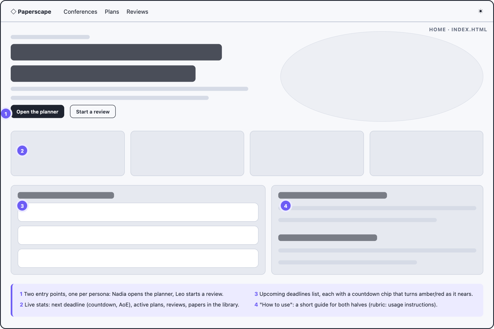

Two entry points (one per persona), live stats, upcoming deadlines with countdowns, and a short "how to use" guide.

### Conference Planner

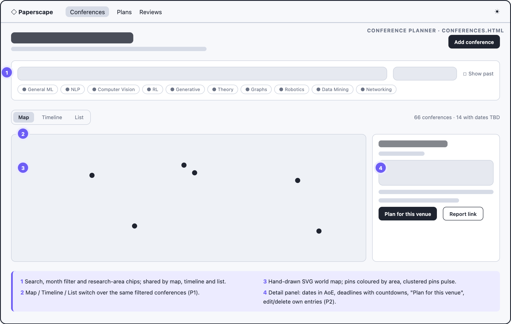

Filters shared by three views of the same conferences (map, timeline, list) and a detail panel with "Plan for this venue".

### Submission plans

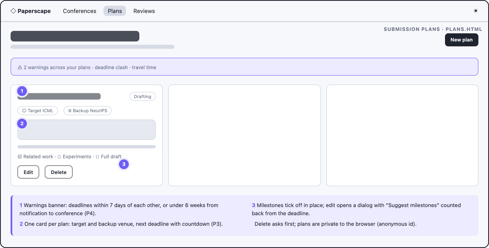

A warnings banner above plan cards; milestones tick off in place; edit opens a dialog with suggested milestones.

### Reviews

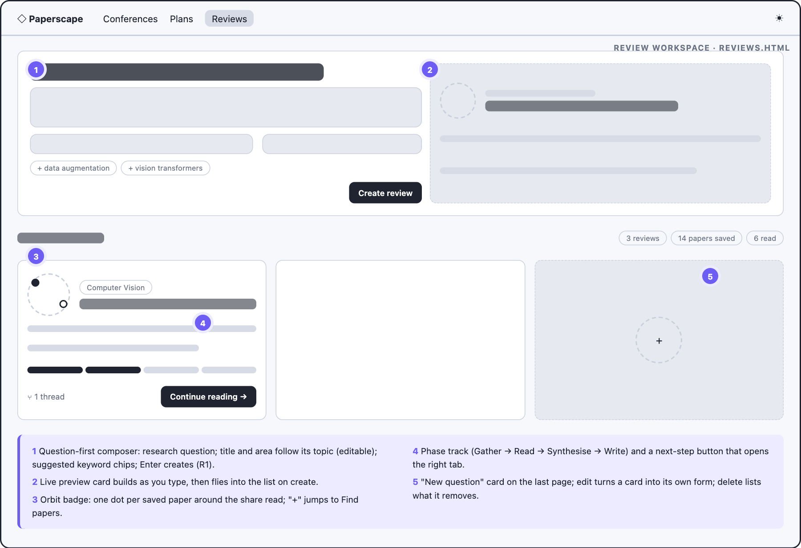

The question-first composer with a live preview; review cards with an orbit badge, phase track and a next-step button; a "New question" card ends the list.

### Review detail

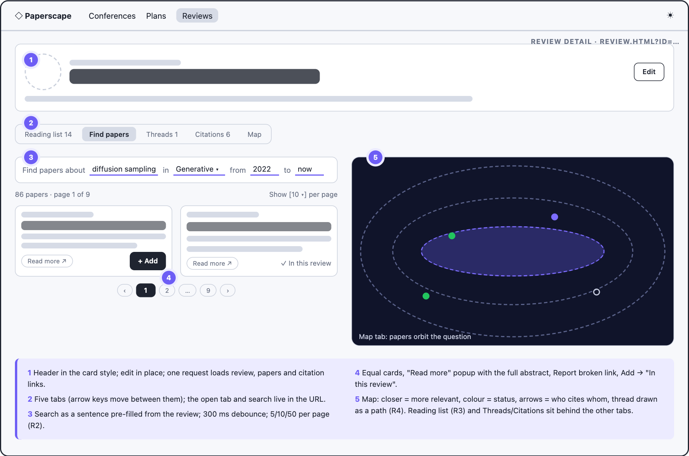

Header and five tabs. Find papers is a search sentence with equal-size result cards and a pager; the Map shows the review's papers orbiting its question.

### Mobile

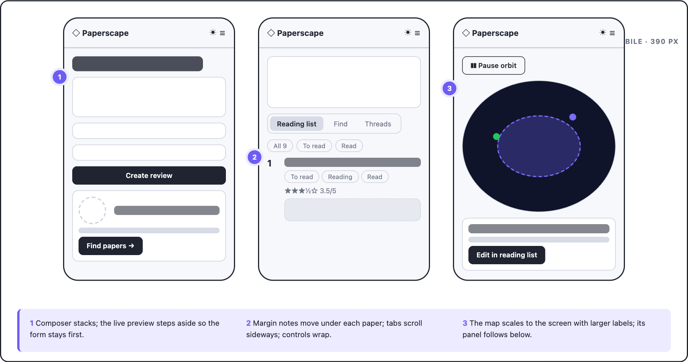

At phone width the composer stacks, margin notes move under each paper, tabs scroll sideways and the map scales with larger labels.

---

## 6. Final screens

|                                                    |                                                        |
| -------------------------------------------------- | ------------------------------------------------------ |
| 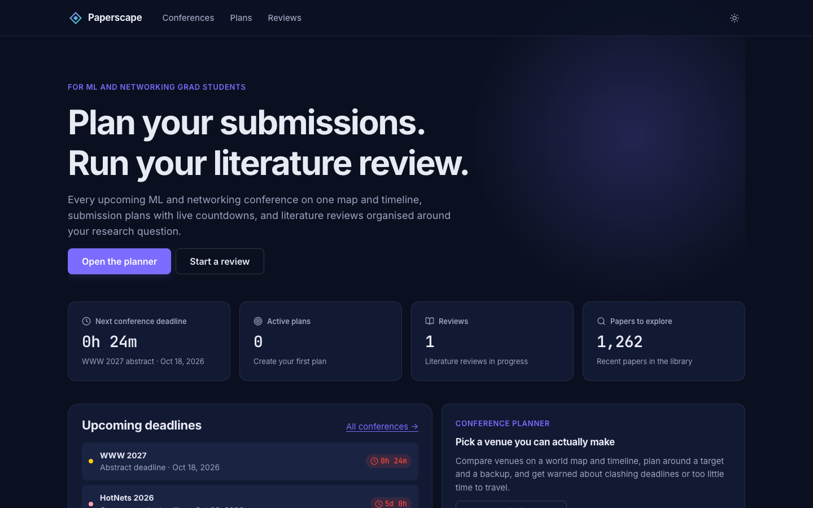                  | 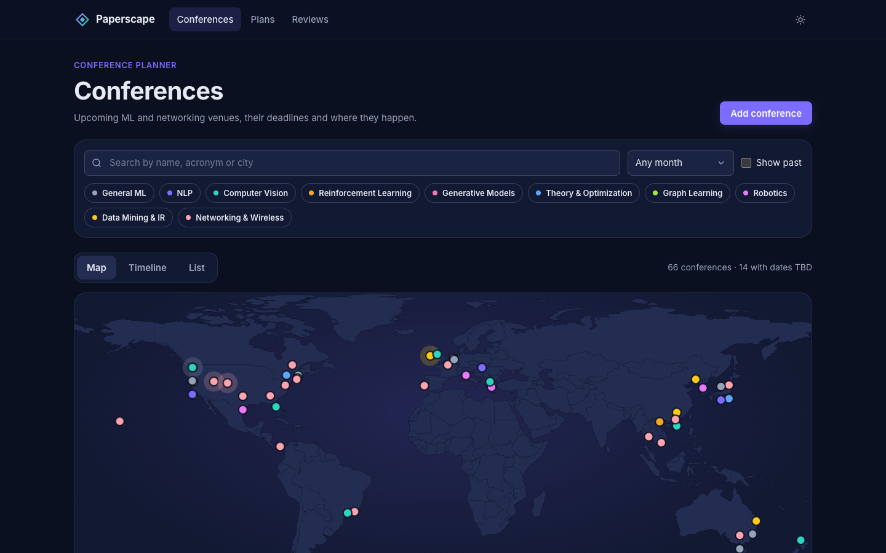 |
| **Home**                                           | **Conference Planner**                                 |
| 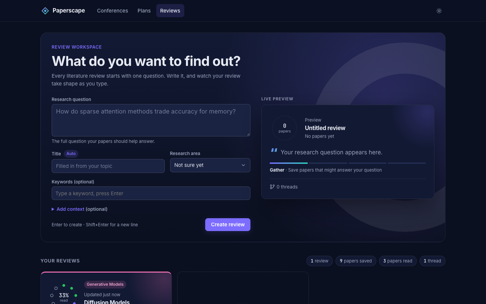            | 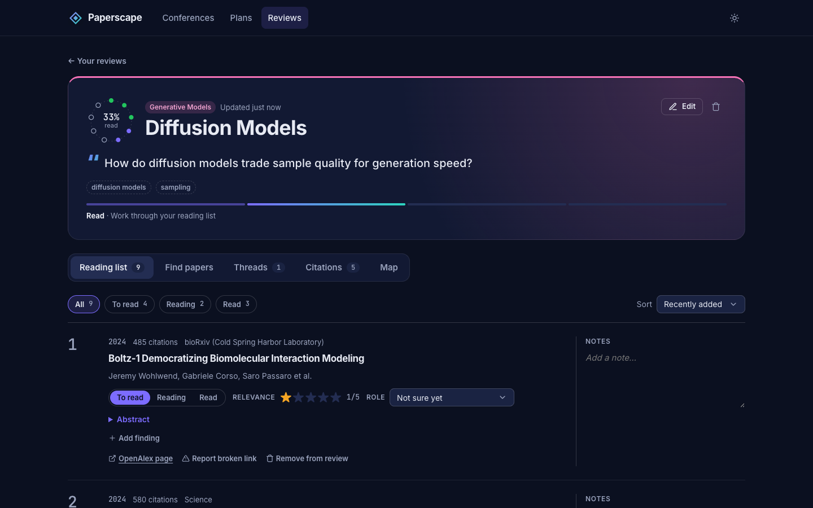       |
| **Reviews: composer and cards**                    | **Reading list with margin notes**                     |
| 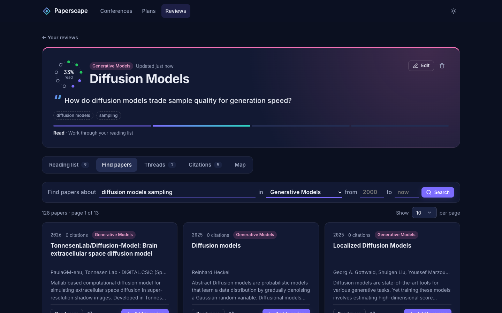    | 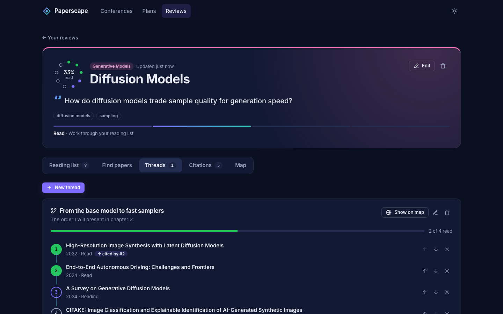         |
| **Find papers**                                    | **Threads**                                            |
| 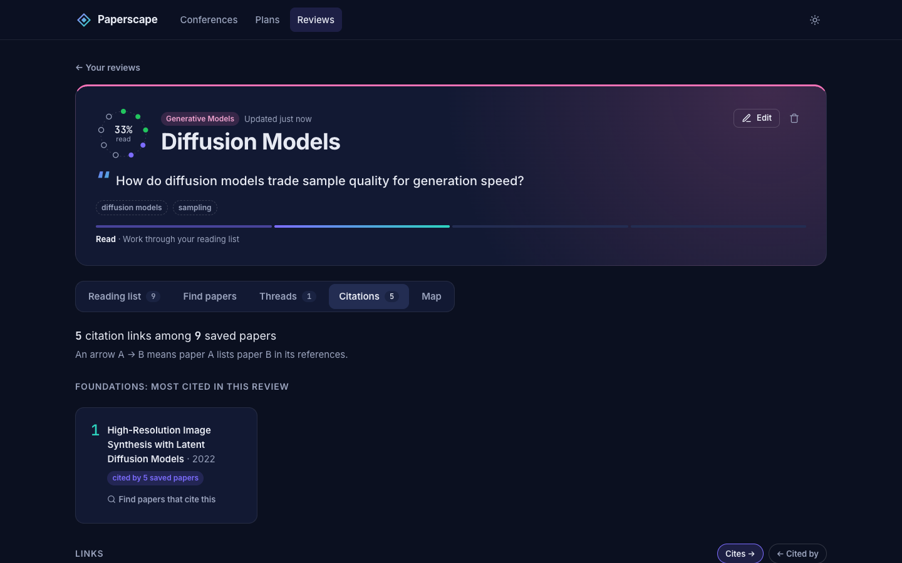 | 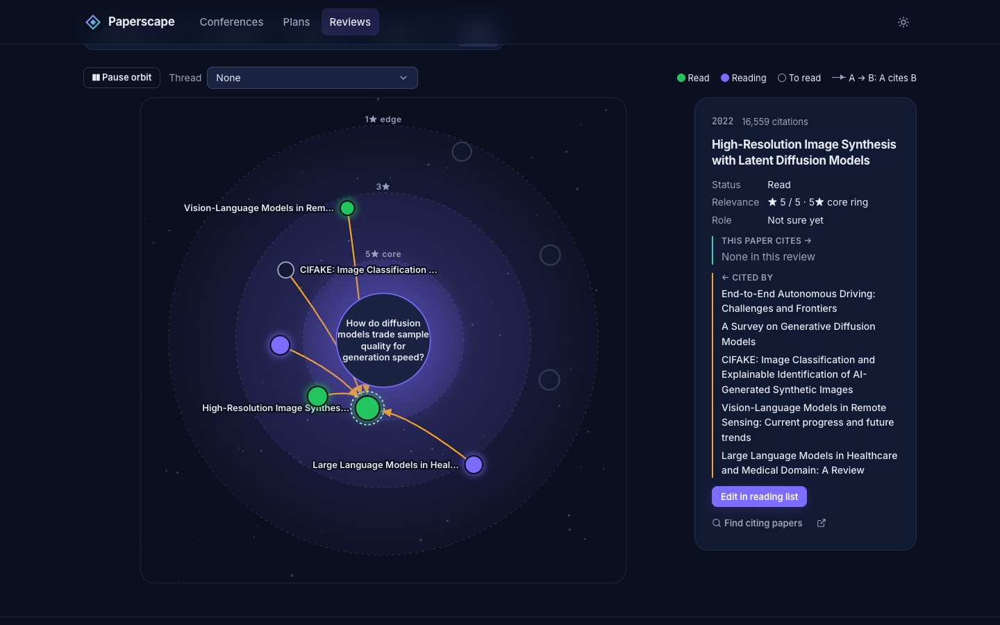                 |
| **Citations**                                      | **Map: papers orbiting the question**                  |

|                                                           |                                               |
| --------------------------------------------------------- | --------------------------------------------- |
| 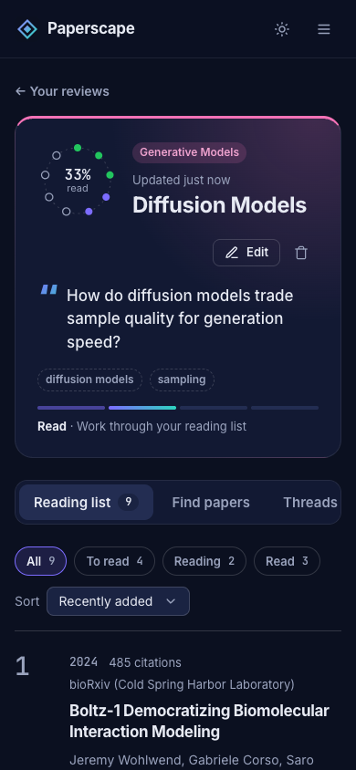 | 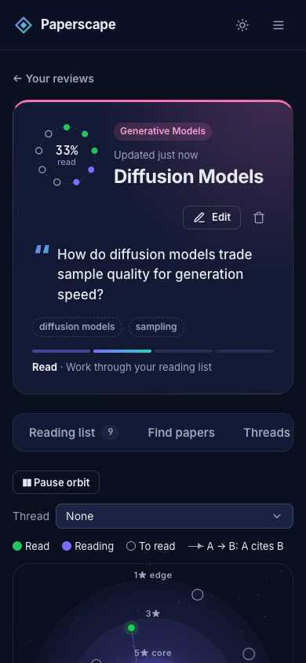 |

---

## 7. Data model

MongoDB with the native driver (no Mongoose). Every document a user owns carries `ownerId`, the anonymous id the browser sends; every query filters by it, and someone else's document answers 404.

| Collection        | Owner      | Purpose                                        | Key fields                                                                                                                                           |
| ----------------- | ---------- | ---------------------------------------------- | ---------------------------------------------------------------------------------------------------------------------------------------------------- |
| `conferences`     | A          | Seeded (public) and user-added conferences     | `acronym`, `year`, `areas[]`, `location`, `startDate`, `endDate`, `deadlines{abstract, paper, notification, cameraReady}`, `ownerId` (null = seeded) |
| `submissionPlans` | A          | A user's plan for one paper                    | `paperTitle`, `targetConferenceId`, `backupConferenceId`, `status`, `milestones[{id, label, dueDate, done}]`                                         |
| `linkReports`     | A          | Broken conference links reported from the site | `conferenceId`, `url`, `reason`, `status`                                                                                                            |
| `papers`          | H (seeded) | 1,262 recent papers from OpenAlex, read-only   | `openalexId` (unique), `title`, `abstract`, `year`, `authors[]`, `venue`, `areas[]`, `citedByCount`, `referencedWorks[]`, `linkReports[]` (private)  |
| `reviews`         | H          | A literature review                            | `title`, `question`, `description`, `keywords[]`, `area`, `threads[{id, title, note, entryIds[]}]` (ordered)                                         |
| `reviewEntries`   | H          | A paper saved in a review                      | `reviewId` → reviews, `paperId` → papers, `status`, `relation`, `relevance` (0.5–5), `notes`, `findings[]`; unique `(reviewId, paperId)`             |

Relationships are references enforced in code: adding an entry checks that the review is yours and the paper exists; deleting a review deletes its entries, and deleting an entry removes it from every thread, each inside a **transaction**. Indexes: a weighted text index on paper title and abstract, `areas + year`, `citedByCount`, the unique keys above, and `ownerId` on every owned collection.

---

## 8. Architecture

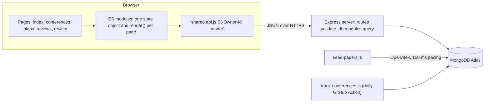

- **Frontend:** plain HTML pages, vanilla JavaScript ES modules and hand-drawn SVG; no frameworks. DOM is built with a small `el()` helper and user text goes in with `textContent`, never `innerHTML`.
- **Backend:** Node + Express, ES modules only. Routes validate input and shape responses; `db/*` modules hold every query; `lib/validation.js` holds shared helpers; one error middleware returns `{ error, details? }`.
- **Data:** OpenAlex is called only by the seed script on a laptop, never by the live site. Conference data refreshes through a daily GitHub Action that opens a review pull request.
- **Hosting:** Render (free tier) deploys every merge to `main`; secrets live in environment variables, never in the repository.

---

## 9. API overview

All routes live under `/api` and need the `X-Owner-Id` header. Errors: `400` validation (with per-field `details`), `404` missing or not yours, `409` conflict.

| Area            | Endpoints                                                                                                                      |
| --------------- | ------------------------------------------------------------------------------------------------------------------------------ |
| Conferences (A) | `GET/POST /conferences`, `GET/PUT/DELETE /conferences/:id`, `POST /conferences/:id/duplicate`, `POST /reports`                 |
| Plans (A)       | `GET/POST /plans`, `GET/PUT/DELETE /plans/:id`, `PATCH /plans/:id/milestones/:mid`                                             |
| Reviews (H)     | `GET/POST /reviews`, `GET /reviews/:id?include=entries,citations`, `PUT/DELETE /reviews/:id`                                   |
| Entries (H)     | `GET/POST /reviews/:id/entries`, `PUT/DELETE /entries/:entryId`                                                                |
| Threads (H)     | `POST /reviews/:id/threads`, `PUT/DELETE /reviews/:id/threads/:threadId`                                                       |
| Citations (H)   | `GET /reviews/:id/citations` → `{ nodes, edges }`                                                                              |
| Papers (H)      | `GET /papers?q&area&yearFrom&yearTo&cites&page&limit`, `GET /papers/:id`, `GET /papers/topics`, `POST /papers/:id/report-link` |

---

## 10. Accessibility, performance and resilience

### Accessibility

- Real buttons, links, labels, fieldsets and dialogs throughout; tabs follow the ARIA tab pattern with arrow keys.
- Star ratings and status controls are radio groups; map papers are SVG links reachable with Tab and Enter, with a list view of the same data.
- Status is shown by fill and shape as well as colour; moving content has a Pause button and respects "reduce motion".
- Layouts were checked at 360, 768, 1280 and 1600 px wide, in dark and light themes, with no sideways scrolling.

### Performance

- One request loads a page's data; every change is one request and updates the page locally.
- Search waits 300 ms after typing, ignores out-of-date responses, fetches only the page asked for and reuses pages already seen.
- Lists that arrive in one request are shown a page at a time; the map animates only while visible.

### What can go wrong, and what happens

| Situation                                                   | What the user sees                                                                           |
| ----------------------------------------------------------- | -------------------------------------------------------------------------------------------- |
| The free server is waking up                                | Placeholders in the shape of the page, then "the server may be waking up…" after 5 s         |
| The server is down or the user is offline                   | A clear message with **Try again** and a way back                                            |
| A save fails                                                | The change is rolled back and a message explains why                                         |
| The review was changed or deleted in another tab            | "This changed in another tab or window", then the latest version reloads                     |
| Adding the same paper twice                                 | "Already in this review"                                                                     |
| A paper's link is dead                                      | **Report broken link**, plus the OpenAlex page as a backup link                              |
| A hand-edited or old link (bad tab, page, year or paper id) | The value is corrected or ignored; a missing review shows "Review not found" with a way back |
| A long title or a phone screen                              | Text wraps or is shortened; controls move instead of squeezing                               |
